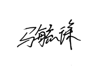
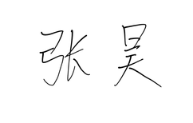
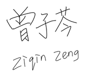

# Process records for group completion

## AI usage log

Tool and date | Purpose and extent | Verification
--- | --- | ---
OpenAI Codex, 22 November 2026, L1-L3 calculations | Prompt stated the physical model and not only the operation: linear DoS g(E) = cE on the positive-energy branch, Fermi-Dirac occupation at 300 K, the two integration limits [0, Emax] and [EF, Emax], the two-carrier Hall closure R_H proportional to (p - n)/(p + n)^2 with R_xx proportional to 1/(p + n), and the required reference checks at C = 1.00, 2.60 and 5.10. Codex then wrote reproduce.py: carrier counts, correction factor, signed Hall inversion, 200-run repeat bootstrap, weighted spatial inversion, resolution and detection-limit tests. Extent: the whole numerical pipeline and the assertion set; the model choices and the acceptance rule were specified by the group and kept. | 马毓琛 re-derived mu = 1/(e n rho) and the C scaling by hand and compared them with the code output. The L1 sweep reproduces the supplied CSV to 2.5e-12 relative, and the closed-form and numerical Fermi-window counts agree to 3.6e-7. Every gate is an assertion in reproduce.py, so a failed check stops the run.
OpenAI Codex, 22 November 2026, figures | Prompts fixed the quantity, units and normalisation of each panel: n_B, n_F and C against Fermi level with the C = 2 and C = 4 crossings marked; separately normalised R_H and R_xx overlays; signed repeats against measurement index; EF against index in acquisition order; the L3 map with the probe-pitch scale. Extent: figures.py and the four figure PDFs. | 张昊 checked each panel against results.json and the raw CSV before the figures were used in the report: the crossing positions 0.07276 and 0.15735 eV match the interpolated values, and the L3 colour scale covers 1.7653% on the regular map. Committed in 050cf64.
OpenAI Codex and a translation tool, 22 November 2026, report draft | Prompts gave the section structure, the word budget and the numbers to be used, and asked for short-paper prose with units and uncertainty attached to each claim. The translation tool was used for Chinese-to-English phrasing only. Extent: a full English draft that the group then edited; the reversed L1 statements described in the ledger below came from this draft and were discarded. | 常雅欣 checked every number in report_source.txt against generated/results.json and the metrics file, and rewrote the passages that did not match. The corrections are visible in the submitted text at L1 (2.430 x 10^4 cm^2 V^-1 s^-1 as a factor 4.284 increase and the sensitivity factor of 4.284) and at L2 (crossing between indices 19 and 20).
OpenAI Codex and a translation tool, 22 November 2026, data handling | Prompts asked for a hash check of the ten supplied files against manifest.json, repeat means per measurement index, and an archive of the classroom blind run with its own commit and log. Extent: data checking, the archive layout and the brief-note text. | 曾子芩 ran the manifest check at the start of each run and confirmed ten of ten hashes; the repeat means were recomputed independently in a spreadsheet and agreed with the code. Archived in da06b0c.
OpenAI Codex, 22 November 2026, classroom-evidence integration & packaging review | Verified the archived blind result, commit and log; restored signed records and blind commit file; assembled the local submission package (committed in 4bfa48f, originally documented in AI_USAGE_ADDENDUM.md). | Checked the archive copies against the originals; reviewed by 马毓琛.
OpenAI Codex, 22 November 2026, repository history | Codex created the Git repository and authored all seven commits in the archive, from b436ab8 (raw data) through 4bfa48f (finalized report and restored submission evidence), under the identity Codex <codex@local.invalid>. Extent: the commit boundaries and messages, not only the file contents. | 马毓琛 checked git log against the working tree and confirmed that each commit contains the files its message names; the final tree reproduces results.json and all four figures from a clean checkout. The Codex identity on those commits is disclosed here rather than attributed to a student.
Antigravity (Gemini), 24 November 2026, final pre-submission audit & polish | Audited the submission package against the assessment brief, practical guide, report guidance and raw G13 data; standardized student IDs to the 2023-prefixed IDs; added explicit L1 parameter/mobility wording, L3 noise-degradation wording, and direct Chapter 3 lecture citation; relaxed requirements.txt pins and added template/NumPy compatibility fallbacks in reproduce.py; harmonized process-record commit counts and rebuilt the PDFs and signature sheet. Numerical results and archived blind data were not altered. | Group reviewed all edits, verified L1-L3 numerical invariance and word counts, and re-ran clean reproduction before final repository push.

## AI error ledger

Date and phase | AI code or claim | Evidence of the failed check | Correction and evidence
--- | --- | --- | ---
22 November 2026, L1 transport scaling | The archived short note stated: "mu_corrected = 24298.49 cm^2/Vs, which is C = 4.284 times smaller than the band-edge mobility at the same resistivity." | The same note reports C = n_band/n_F = 4.2841 and a band-edge mobility of 5,671.79 cm^2 V^-1 s^-1. The ratio 24,298.49/5,671.79 equals 4.2841, so the corrected value is larger by C, not smaller. The sentence also contradicts the preceding line of the same paragraph, which says the substitution multiplies mu by C. Check: the assertion abs(mu_F/mu_B - C) < 1e-6 passes, while abs(mu_F/mu_B - 1/C) is 4.05 and fails. This is a physics error: mu = 1/(e n rho) rises when the carrier count falls. | The direction was reversed to a factor 4.284 increase. The submitted report states the band-edge and Fermi-window mobilities as 5.672 x 10^3 and 2.430 x 10^4 cm^2 V^-1 s^-1 for the same resistivity, and reproduce.py returns both values from the same sheet resistance. Evidence: report_source.txt L1 section, generated/analysis_metrics.json fields mobility_band and the L1 block of results.json.
22 November 2026, L1 sensor advice | The same note concluded: "Any sensitivity figure derived from the band-edge count should be divided by 4.28 at this operating point." | Under the response model S proportional to 1/n used in the report, the Fermi-window count n_F = 5.2273 x 10^11 cm^-2 is 4.2841 times smaller than n_band = 2.239 x 10^12 cm^-2, so S must be 4.2841 times larger, not smaller. The note applied the density ratio to the sensitivity with the wrong sign. | The report now says a sensitivity 4.284 times the band-edge estimate should be used at this operating point, conditional on S proportional to 1/n. Evidence: report_source.txt L1 section, final paragraph; L1 results.json correction_factor 4.2841000116 and n_fermi_op_cm2 5.2273 x 10^11.
22 November 2026, L2 neutrality crossing | The archived L2 brief note stated that the assigned Fermi level crosses neutrality "between indices 20 and 21". | Recomputing the three-repeat mean of R_H_raw gives +5.151 x 10^-13 at index 19 and -1.792 x 10^-14 at index 20, so the sign change lies between 19 and 20; index 20 is already negative. The signed trajectory in results.json agrees: -3.045 x 10^-3 eV at index 19 and +2.592 x 10^-4 eV at index 20. The code's own bracket list is [[19, 20]], so the prose and the calculation disagreed. Check: the sign of the repeat mean is asserted at the bracketing indices. | The report now states the crossing between indices 19 and 20 and keeps the Hall sign in the normalisation. Evidence: report_source.txt L2 section; generated/analysis_metrics.json field brackets; L2_data.csv sign change.
22 November 2026, reproducibility (software, not physics) | The first version of the entry point imported a plot module that was not present at its first run. | It wrote numeric outputs but exited with ModuleNotFoundError before generating the plots. | Added the plot module, then regenerated the result and all four figures from a clean checkout. This is a software integration error and is not counted as a physics error.

The three physics entries above were each detected by comparing an AI-written statement with a number that the code had already produced, and each correction is visible in the submitted report. The coursework rewards evidence of genuine physics errors; the software integration issue is listed for completeness only.

## Contribution statement

Name and ID | Substantive L1 contribution | L2 contribution | L3 contribution | Report, verification or code evidence | Signature and date
--- | --- | --- | --- | --- | ---
马毓琛 (2023304327) | Specified the band-edge and Fermi-window integration limits, derived the correction factor and corrected mobility by hand, and verified the 1.00, 2.60 and 5.10 reference gates | Specified and verified the two-carrier closure, separate channel normalisation, 200-run repeat bootstrap and Fermi-level assignment | Specified and verified the zero-mean weighted inversion, eta sweep, point-spread resolution test and noise propagation | Directed and verified reproduce.py (commit 050cf64); L1-L3 blocks of results.json; hand derivation of mu = 1/(e n rho) | Signed 22 Nov 2026 |
张昊 (2023304290) | Specified and verified Figure 1 (n_B, n_F and C against Fermi level with C = 2 and C = 4 crossings marked) | Specified and verified the signed-repeat, channel-overlay and EF-versus-index panels and checked acquisition order | Specified and verified the map and method figures with probe-pitch scale and eta sweep panel | Directed and verified figures.py (commit 050cf64); four figure PDFs under generated/ | Signed 22 Nov 2026 |
常雅欣 (2023304286) | Directed, audited and revised the L1 question, method, result and sensor advice, correcting the reversed scaling statements | Directed, audited and revised the L2 model-selection, gap, trajectory text and device recommendation | Directed, audited and revised the L3 method, resolution, detection-limit and pass/fail text, plus the transfer section and references | Audited and revised report_source.txt (commit 67f7a3d); number-by-number check against results.json | Signed 22 Nov 2026 |
曾子芩 (2023304371) | Ran the manifest hash check and verified the operating point, temperature and sheet resistivity from metadata | Independently recomputed three-repeat means per index in a spreadsheet and verified acquisition order | Handled the blind dataset, row-major pixel convention and archival of the classroom blind run | data/manifest.json check at run start; classroom_blind/ archive (commit da06b0c) | Signed 22 Nov 2026 |

The group confirms that these entries match the work performed. As disclosed in the AI usage log, AI assistants were used for code generation, typesetting and packaging, and the initial repository history was authored under the Codex identity; the table above records which group member directed, physically verified and signed off each component, alongside the session checkpoints and handwritten signatures. The archived classroom blind evidence is in classroom_blind/. All four members signed and dated this statement on 22 November 2026; the subsequent 24 November 2026 pre-submission review preserved all numerical outputs and group attributions.

## Signatures

Each member signed by hand on 22 November 2026. The original signatures are reproduced below and the image files are in signatures/.

**马毓琛 (2023304327)** - signed 22 November 2026

**张昊 (2023304290)** - signed 22 November 2026

**常雅欣 (2023304286)** - signed 22 November 2026

**曾子芩 (2023304371)** - signed 22 November 2026
